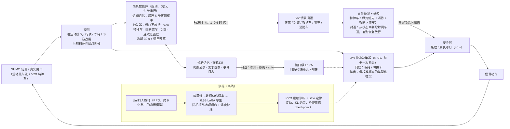

# JevTraffic 中期汇报 PPT 框架

> 共约 20 页。每页给出标题、要点、建议配图和讲稿提示。数字全部来自 `docs/项目总结.md` 与 `results/sumo/main_tables.md`（3 个种子，ATT 单位为秒，越低越好）。

---

## 第 0 页 · 封面

- 题目：**JevTraffic：基于类型化快速决策与情景记忆的可迁移交通信号控制**
- 汇报人 / 单位 / 日期
- 一行副标题：*一次前向即可决策的小模型 + 按需调用的情景智能体*

---

## 第一部分 · 选题意义与难点（4–5 页）

### 第 1 页 · 为什么做交通信号控制

- 路口信号是城市路网的"瓶颈开关"：延误、排队、尾气和应急响应都直接受它影响。
- 部署要求天然苛刻：**每 5 s 要做一次决策**，路口千差万别，并且要应对突发事件。
- 现有方法大致是三条路线：规则控制（FixTime / Webster / SOTL / MaxPressure）→ 端到端强化学习（IntelliLight、PressLight、AttendLight、UniTSA）→ 大语言模型智能体（LLMLight、USTBench 等）。三条路线都还没有同时做到"可迁移、实时、能处理突发、有记忆"。
- 配图：城市路口照片，加上三条路线的时间轴。

### 第 2 页 · 难点一：迁移能力弱，零样本差

- 端到端 RL 学的是"这个路口、这种车流"，换一个路口就失效。
- 我们的实测（训练路口 → 从未见过的路口，无事件）：

  | 方法 | 训练路口 | 未见路口 |
  |---|---|---|
  | IntelliLight | 37.3 | **87.9** |
  | PressLight | 41.2 | **103.7** |
  | AttendLight | 41.9 | 60.9 |
  | UniTSA（专门为通用而设计） | 38.0 | 50.1 |
  | MaxPressure（规则，无需训练） | 39.2 | 53.9 |

- 难点在于：路口的相位数（3 或 4）、几何朝向、车道结构都不同，固定维度的状态和动作空间很难对齐，少量样本的在线适配又容易把模型"调坏"（AttendLight 适配 50 个 episode 后为 118.3 s）。
- 配图：柱状图，同一方法在训练路口和未见路口上的 ATT 对比。

### 第 3 页 · 难点二：LLM 的准确性与效率难以兼得

- 用 LLM 做推理有优势：能理解自然语言描述的状态，零样本泛化更好，也容易接入智能体框架。
- 代价是：生成式推理（CoT）每个决策约 **1.9 s**（Qwen2.5-7B，CityFlow 实测），远超 5 s 决策周期下多路口并发的预算；显存要 15 GB 左右，部署成本高。
- 直接把 LLM"压缩"成选择题也不行：零样本单次读出的 Jev 与 MaxPressure 的一致率只有 3–17%，置信度却高达 0.97。原因是位置偏置和过度自信。
- 难点在于：**既要 LLM 的表示能力，又要毫秒级、可量化置信度的输出。**
- 配图：左边是"生成式 CoT"的一长串 token，右边是"一次前向 → 选项概率"，下面标出两者的耗时。

### 第 4 页 · 难点三：情景差异大，一个模型难以兼顾

- 同一个路口会遇到截然不同的情景：
  - **拥堵**：各个方向都排满车，需要权衡放行时长；
  - **车祸 / 封道**：某个方向有车但绿灯也放不走，继续给绿灯就是浪费；
  - **特种车辆**：警车、救护车、消防车需要优先通行。
- 让一个端到端模型同时学会所有情景并不合理：训练目标互相冲突，罕见情景的样本又少，参数空间里噪声大。
- 为每种情景各训练一个端到端模型，成本又随"情景 × 路口"成倍增长。
- 配图：同一路口三种情景的示意图（拥堵 / 封道 / 特种车）。

### 第 5 页 · 难点四：缺乏短期与长期的路口记忆

- 主流端到端控制器只看当前（或最近几帧）的观测，**没有显式的路口记忆**。
- 短期记忆的缺失：几分钟前发生了车祸，对应的策略（不给封闭车道放绿灯）应该一直延续到恢复为止，但模型每一步都在"重新开始"。
- 长期记忆的缺失：同一个路口每天的通勤高峰、历史事件都无法沉淀下来，也无法据此做路口级的个性化。
- 配图：时间轴，车祸发生 → 持续封道 → 恢复，对比"无记忆策略的反复横跳"和"有记忆策略的持续执行"。

---

## 第二部分 · 我们的方法（5–6 页）

### 第 6 页 · 核心思路：快思考 + 慢思考的分工

- **快系统（每一步都运行）**：Jev 式类型化决策器。状态用文本表示，问题是"保持当前绿灯还是切换？"，模型做一次前向，读出选项字母的概率，不生成文本。
- **慢系统（只在需要时运行）**：规则化的情景智能体维护短期记忆，满足触发条件时才向同一个模型提一个"情景识别"问题，再按识别结果调用对应的事件预案。
- **长期记忆**：按路口存储历史决策与需求画像，可按天 / 按周做路口级 LoRA 微调，验证通过才部署。
- 一句话：**常态决策要快，异常情景要准，记忆让策略能延续。**

### 第 7 页 · 整体架构图

- 讲稿提示：先讲中间的快速通路，再讲上方的情景通路，最后讲下方的记忆与训练。

### 第 8 页 · 解决难点一（迁移）：路口无关的类型化状态 + 通用教师蒸馏

- **状态与具体路口无关**：用"进口方向 + 转向"命名每个运动（如 `north left`），每个相位都写成它放行的运动，所以 3 相位和 4 相位、不同几何的路口都能用同一种语言描述，不需要固定维度。
- **从通用教师蒸馏**：UniTSA 在 9 个训练路口上训练，0.5B 学生用它的动作概率做软目标（6.5 万条），同时学习情景问题。
- **小样本适配加验证门控**：在目标路口上用小学习率、少量更新做适配，只有在验证种子上优于零样本模型才部署，保证适配"不会更差"。
- 结果预告：未见路口上 **48.4 s，优于教师 UniTSA（50.1）**，也优于所有 RL 基线。

### 第 9 页 · 解决难点二（效率）：一次前向的 System One 决策

- **不生成文本**：把状态和选项写成一轮对话，读答案位置上选项字母的 logits，在这些字母上做 softmax，得到各选项的概率。输出不可能无效，并且天然带置信度。
- **去偏与校准**：训练时随机打乱选项顺序，消除位置偏置；用单一温度做校准，ECE 降到 0.02–0.07，置信度可以用于门控。
- **小模型**：0.5B 学生在 GPU + CUDA graphs 下 **4.6 ms/决策**（batch 8 时 2.5 ms），显存 1.3 GB。
- 对比：生成式 CoT 约 1900 ms；7B Jev 73–117 ms；UniTSA（CPU）3.6–8.6 ms。
- 配图：耗时对比的对数坐标柱状图。

### 第 10 页 · 解决难点三（多情景）：情景解耦，按需识别、按情景执行

- 不让一个模型背所有情景：**常态决策**交给快速决策器；**异常情景**由情景智能体触发识别，并交给规则化的事件预案执行。
- 同一个 LLM 回答不同的类型化问题（保持 / 切换、情景五分类），多任务共享参数，但输出空间彼此独立，避免一个混杂的端到端目标。
- 事件预案：
  - 特种车：从 V2X 找到所在车道，映射到运动和相位，保持绿灯直到通过停止线（最长 30 s），之后恢复，并由防饥饿机制优先补偿等待最久的相位。
  - 封道：标记封闭车道，把它从状态的排队数里剔除，避免把绿灯浪费在放不走的车上；车道恢复放行后自动解除。
- 成本：触发式只在 **1.2–1.9%** 的步上额外调用一次。每步都调用时每步 258–340 ms，而 ATT 没有更好。

### 第 11 页 · 解决难点四（记忆）：短期记忆延续策略，长期记忆沉淀路口知识

- **短期记忆**：最近 5 步的环形缓冲，记录每个运动的排队、放行量、相位和置信度。触发时把它渲染成一张紧凑的表格交给 Jev，用来判断"绿灯了却放不走"这类需要时间上下文的情景。
- **策略延续**：识别出的事件变成带生命周期的状态，比如封道一直生效到车道恢复放行，特种车预案一直生效到车辆通过，而不是每一步重新判断。
- **长期记忆**：按路口存储决策记录、5 分钟粒度的需求画像和事件日志。需求画像用于"排队突增"触发器；可选按天 / 按周训练路口 LoRA，只有回放验证更好才部署；`auto` 模式在共享模型已经足够好时不训练、不存参数。

---

## 第三部分 · 实验（7–8 页）

### 第 12 页 · Benchmark 与设置

- **主平台：SingleTSCBaselines**（SUMO + TransSimHub）
  - 12 个真实路口（北京 6、天津 1、成都 2、法国 Massy、韩国松岛、香港 YMT）× easy/normal 两种路网 × 5 种需求模式（低密度、高密度、通勤波动、需求递增、随机扰动）。
  - 一个 episode 1000 s，每 5 s 决策一次，黄灯 3 s。
  - 内置事件注入：事故封道，以及警车 / 救护车 / 消防车。
- **划分**：9 个路口用于训练；**3 个路口完全留出**（Massy、松岛、YMT）；需求模式 random_perturbation 也留出。
- **评测分组**：seen（训练路口 × 训练模式）、pattern（训练路口 × 留出模式）、junction（留出路口 × 全部模式）。
- **事件设置**：无事件 / 官方 event_1 / 两组随机事件。
- **种子**：测试用 SUMO 种子 0–2；验证用种子 100，与测试严格分离。
- **前期平台**：USTBench（CityFlow，杭州 / 济南），用于验证 Jev 式读出的可行性。

### 第 13 页 · Baselines

| 类别 | 方法 | 出处 |
|---|---|---|
| 规则 | FixTime | 经典定时控制 |
| 规则 | Webster | Webster，1958（Road Research Technical Paper） |
| 规则 | SOTL | Cools et al.，2008（自组织信号控制） |
| 规则 | MaxPressure | Varaiya，2013（Transportation Research Part C） |
| 强化学习 | IntelliLight | KDD 2018 |
| 强化学习 | PressLight | KDD 2019 |
| 强化学习 | AttendLight | NeurIPS 2020 |
| 强化学习 | UniTSA | IEEE TVT 2024 |
| 大语言模型 | 生成式 CoT（Qwen2.5-7B，USTBench 方式） | USTBench，arXiv 2025 |

- 说明：所有 RL 基线都按"跨 9 个训练路口的通用模型"训练，与 UniTSA 的设置对齐，以便公平比较零样本迁移。

### 第 14 页 · 评价指标

- **ATT**（平均通行时间，主指标）；另报 AWT（平均等待时间）。
- **特种车 timeLoss**：特种车相对自由流多花的时间。
- **事件识别**：特种车识别率、封道检出数、误报次数。
- **效率**：每次决策耗时（ms）、额外调用比例、显存。
- **决策质量**：与教师 / MaxPressure 的一致率，以及校准误差 ECE。

### 第 15 页 · 实验设计一览

| 实验 | 目的 | 策略 |
|---|---|---|
| E1 零样本迁移 | 难点一 | 所有方法在 seen / pattern / junction × 三类事件下比较 |
| E2 小样本适配 | 难点一 | 在留出路口上用 1 / 10 / 50 个 episode 做适配，加验证门控 |
| E3 推理效率 | 难点二 | 生成式 CoT vs 7B Jev vs 0.5B Jev（是否 CUDA graphs） |
| E4 情景智能体 | 难点三、四 | 不用记忆 / 每步调用 / 触发式调用，比较 ATT 与额外调用比例 |
| E5 特殊事件 | 难点三 | 无预案 / 规则检测 + 预案 / Jev 检测 + 预案 |
| E6 长期记忆 | 难点四 | 14 个模拟日，off / daily / weekly / auto |
| E7 训练策略消融 | 方法改进 | 蒸馏 → + RL（Little 定律奖励，KL 0.2 / 0.5，验证选 checkpoint）→ DAgger / 布局增强 |

### 第 16 页 · 结果一：零样本迁移（主表一）

| 方法 | 训练路口 | 留出模式 | **留出路口** | 留出路口 + event_1 | 留出路口 + 随机事件 |
|---|---|---|---|---|---|
| MaxPressure | 39.2 | 39.2 | 53.9 | 57.2 | 54.2 |
| IntelliLight | 37.3 | **37.3** | 87.9 | 87.6 | 87.3 |
| PressLight | 41.2 | 39.1 | 103.7 | 108.9 | 103.0 |
| AttendLight | 41.9 | 40.5 | 60.9 | 64.3 | 60.5 |
| UniTSA | 38.0 | 38.5 | 50.1 | 53.1 | 50.3 |
| **Jev（蒸馏）** | 38.0 | 38.5 | **48.4** | 52.5 | **48.7** |
| **Jev（蒸馏）+ 事件预案** | 38.0 | 38.5 | **48.4** | **51.3** | 49.0 |
| **Jev（蒸馏 + RL）** | **37.3** | 37.7 | 48.5 | 52.9 | 49.2 |

- 结论：Jev 在留出路口上最好（比 UniTSA 低 1.7 s，比 MaxPressure 低 5.5 s）；RL 版本在训练路口上最好，在留出路口上与蒸馏版持平；DQN 基线一换路口就崩溃。

### 第 17 页 · 结果二：小样本适配（主表二与预算曲线）

| 方法 | 0 | 1 | 10 | 50 个 episode |
|---|---|---|---|---|
| IntelliLight | 87.5 | 76.1 | 70.3 | 67.1 |
| PressLight | 104.6 | 85.5 | 74.1 | 65.8 |
| AttendLight | 61.6 | 61.1 | 60.7 | 61.6（不加门控时为 118.3） |
| UniTSA | 51.0 | 50.9 | 51.0 | 50.9 |
| **Jev（蒸馏 + RL）** | **50.0** | **49.9** | **49.9** | **49.8** |

- 结论：Jev 在任何预算下都最好；验证门控避免了适配带来的崩溃；零样本已经很强的方法从小样本中获益有限。
- 配图：预算曲线折线图（横轴为 episode 数，纵轴为 ATT）。

### 第 18 页 · 结果三：效率、情景智能体与特殊事件

- **效率**：0.5B Jev 4.6 ms/决策，与 UniTSA 的 CPU 开销同一量级，比生成式 CoT 快约 400 倍，比 7B 快 15–25 倍。
- **情景智能体**：触发式只在 1.2–1.9% 的步上额外调用，每步 73–103 ms（7B）；每步都调用为 258–340 ms，ATT 没有更好。
- **特殊事件**：

  | 控制器 | 特种车 timeLoss（event_1） | 特种车 timeLoss（随机事件） |
  |---|---|---|
  | UniTSA（无预案） | 30.8 | 21.7 |
  | Jev 0.5B + 事件预案 | 19.6 | 15.0 |
  | Jev 7B + 事件预案 | 15.3 | 13.8 |

  250 辆特种车全部识别；总 ATT 基本不变。
- **长期记忆**：14 个模拟日里，共享模型已经比 MaxPressure 好 0.7–8.0%；路口级 LoRA 没有一次通过验证，因此 `auto` 模式不训练、不存参数，节省了存储与计算。

### 第 19 页 · 结果四：训练策略消融与经验

| 学生 | 训练路口 | 留出路口 |
|---|---|---|
| v3 蒸馏 | 38.0 | 48.4 |
| + 布局增强 | 37.8 | 48.3 |
| + DAgger（两轮） | 37.9 | 48.6 |
| + PPO（Little 定律奖励，KL 0.2，验证选 checkpoint） | **37.3** | 48.5 |

- RL 的奖励设计很关键：v4 用等待时间奖励会漂移，v5 改为 Little 定律（路口内车辆数）加少量等待惩罚、加大 KL 后，训练才稳定。
- DAgger 和增强没有带来额外收益：学生与教师在自身访问到的状态上已经一致 85–89%。
- 经验：**状态表示比训练技巧更重要**。修正松岛路口的方位命名（该路口旋转约 45°，原来被命名为 north / north-2 / south / south-2）之后，留出路口从 49.4 降到 48.4，RL 版从 55.0 降到 48.5。

---

## 第四部分 · 总结与下一步（2 页）

### 第 20 页 · 总结

1. **迁移**：用路口无关的类型化文本状态，加上通用教师的软蒸馏，0.5B Jev 在未见路口上取得最好的零样本成绩（48.4 s），优于 UniTSA 和全部 RL 基线；小样本适配加验证门控后不会比不适配更差。
2. **效率**：一次前向的类型化决策，4.6 ms/决策，比生成式 LLM 快两到三个数量级，同时提供校准过的置信度。
3. **多情景**：快速决策与情景识别解耦，触发式调用只占 1–2% 的步，特种车延误下降 30–50%，总通行时间不受影响。
4. **记忆**：短期记忆让事件策略持续生效；长期记忆按路口沉淀数据，并能自动判断"不需要微调"。
5. **诚实的局限**：RL 只在训练分布内带来提升；DAgger 和增强没有额外收益；小样本适配对零样本已经很强的模型提升有限。

### 第 21 页 · 下一步规划

- **状态增强**：把 UniTSA 能看到而 Jev 看不到的车道数、占有率、平均速度加入文本状态，继续缩小与教师的差距并争取超越。
- **从单路口到路网**：多路口协同（邻接路口的上下游信息、绿波），在更大路网上验证。
- **更强的学生与 RL**：1.5B / 3B 学生；以教师为参考的 KL；在更多样的需求下训练 RL。
- **事件评测补全**：在最新模型上完整重跑特种车与封道指标；更多事件类型（施工、大型活动）。
- **走向部署**：真实路口数据回放、CPU / 边缘端推理优化。
- 时间规划：建议用甘特图展示到期末的里程碑。

---

## 附录（备用页）

- A1：v1 结果（CityFlow）：零样本与微调后的 ATT，以及三阶段微调与温度校准。
- A2：USTBench 相位映射问题的说明。
- A3：每个留出路口的分解结果（Massy / 松岛 / YMT）。
- A4：RL checkpoint 选择曲线（20 个候选的验证 ATT）。
- A5：小样本验证门控对每个方法保留了哪些适配模型。
