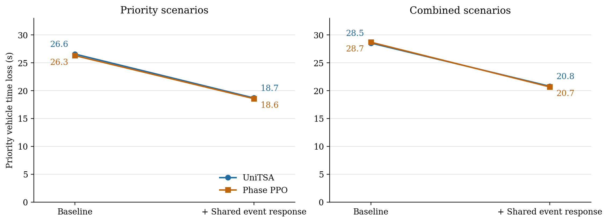
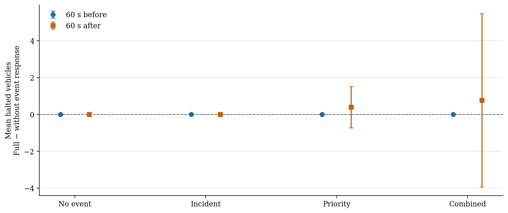
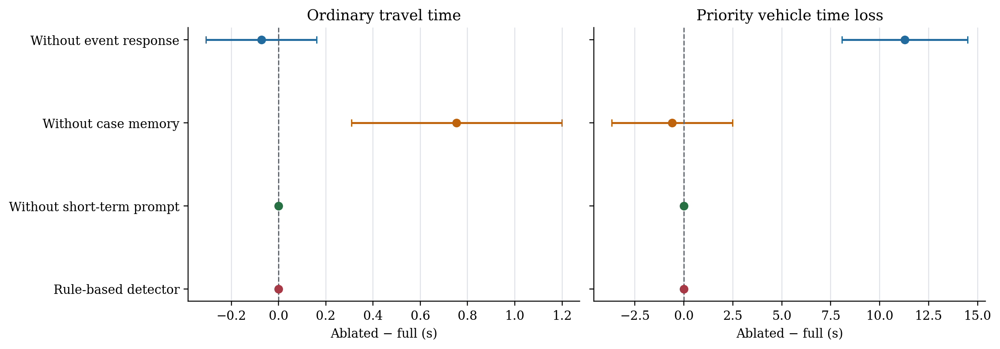
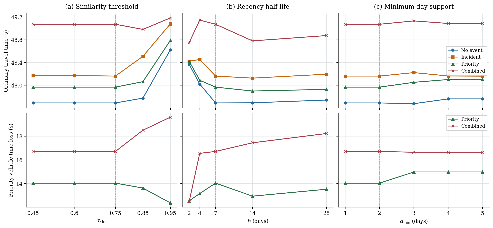
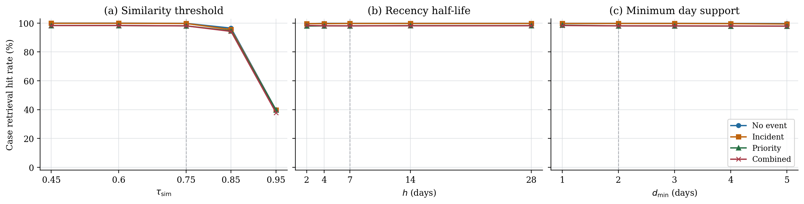

# JevTraffic 事件适配、模块消融与敏感性分析

## 1. 事件适配探索

对 UniTSA 和 Phase PPO 复用 864 个固定 SUMO 场景，覆盖 Massy、Songdo、YMT，两个路网版本、三种交通需求和四种事件条件。每个基线的网络权重、动作空间、车流随机种子和事件注入保持一致。适配组增加统一事件规则，使用 60 m V2X 接近检测、有限连续干预和排队停滞响应。Phase PPO 的三个训练权重先对同一场景求平均。每种事件有 216 个场景，每个流量子组有 72 个。

加入适配后，两种基线在仅特种车和复合事件中的特种车平均时间损失减少 **7.73–8.02 秒（27.2%–29.7%）**。两种基线在无事件条件下的普通车 ATT 完全一致。有特种车的场景中，普通车 ATT 的平均差为 -0.20 至 -0.12 秒，特种车在各组都完成行程。P95 按场景统计，Phase PPO 先对训练权重求平均。

| 基线 | 事件 | timeLoss 未适配 → 适配 (s) | Δ (s) [95% CI] | 低 / 高流量 Δ (s) | P95 未适配 → 适配 (s) |
| --- | --- | --- | --- | --- | --- |
| UniTSA | 特种车 | 26.56 → 18.68 | -7.89 [-9.87, -5.90] | -2.69 / -15.34 | 57.83 → 43.18 |
| UniTSA | 复合事件 | 28.53 → 20.78 | -7.75 [-9.87, -5.63] | -2.08 / -15.18 | 72.96 → 41.62 |
| Phase PPO | 特种车 | 26.28 → 18.55 | -7.73 [-9.09, -6.37] | -1.80 / -16.50 | 58.76 → 36.22 |
| Phase PPO | 复合事件 | 28.68 → 20.66 | -8.02 [-9.41, -6.64] | -3.00 / -15.29 | 68.84 → 40.06 |

下表用新场景比较完整 JevTraffic 和关闭事件执行的 JevTraffic。时间锚点是排定的特种车发车时刻。无事件与事故单独场景使用同车流下的对应锚点。统计前后 60 秒内各进口车道的停车车辆数，用相邻控制时刻间隔加权。差值为完整方案减去关闭事件执行。高低流量是仿真中的需求档位。复合事件按排程定义，车辆接近与物理封道的实际重合由逐场景数据单独记录。

| 场景 | 前 60 秒 | 后 60 秒 | 前后变化之差 |
| --- | --- | --- | --- |
| 无事件 | 0.00 [0.00, 0.00] | 0.00 [0.00, 0.00] | 0.00 [0.00, 0.00] |
| 事故封道 | 0.00 [0.00, 0.00] | 0.00 [0.00, 0.00] | 0.00 [0.00, 0.00] |
| 特种车 | 0.00 [0.00, 0.00] | +0.39 [-0.72, +1.51] | +0.39 [-0.72, +1.51] |
| 复合事件 | 0.00 [0.00, 0.00] | +0.77 [-3.93, +5.47] | +0.77 [-3.93, +5.47] |

## 2. 模块消融

新回放包含 24 套车流种子和 **96 个场景**，覆盖三个留出路口、两个路网版本、两档流量和四种事件。各组使用同一份蒸馏模型，启用记忆的组使用同一份七天只读案例库。关闭事件执行同时关闭信号抢占和封闭车道屏蔽。移除短期历史提示只清空提供给情景分类器的历史行，触发器仍读取最近五步。规则对照保留触发器及事件管理器。

完整方案普通车 ATT 为 **48.11 秒**，特种车 timeLoss 为 **15.58 秒**。表中 Δ 为消融组减完整方案，正值表示通行代价上升。两列通行指标为逐项 95% 区间，最右列为四个预定主对照的 Bonferroni 校正结果。

| 消融组 | 普通 ATT Δ (s) | 特种车 timeLoss Δ (s) | 主对照 Δ（98.75% CI） |
| --- | --- | --- | --- |
| 移除事件执行 | -0.07 [-0.31, +0.16] | +11.28 [+8.07, +14.50] | 特种车 timeLoss +11.28 [+6.61, +15.95] |
| 移除长期案例记忆 | +0.75 [+0.31, +1.20] | -0.60 [-3.69, +2.49] | 普通 ATT +0.75 [+0.11, +1.40] |
| 移除短期历史提示 | 0.00 [0.00, 0.00] | 0.00 [0.00, 0.00] | 特种车 timeLoss 0.00 [0.00, 0.00] |
| 以规则替代 Jev 情景识别 | 0.00 [0.00, 0.00] | 0.00 [0.00, 0.00] | 特种车 timeLoss 0.00 [0.00, 0.00] |

校正后的主对照支持完整方案保留这些能力。对应移除项为移除事件执行、移除长期案例记忆。移除短期历史提示、以规则替代 Jev 情景识别这两项对照的交通指标在全部 96 个场景中均与完整方案一致。

| 组别 | 普通车辆完成数 | 特种车完成数 |
| --- | --- | --- |
| 完整 JevTraffic | 44799/44804 | 48/48 |
| 移除事件执行 | 44799/44804 | 48/48 |
| 移除长期案例记忆 | 44804/44804 | 48/48 |
| 移除短期历史提示 | 44799/44804 | 48/48 |
| 以规则替代 Jev 情景识别 | 44799/44804 | 48/48 |

### 案例记忆的独立种子复核

另用原始合并 PR 在 864 个固定场景上的回放，核对同一模型、有无案例记忆的差异。该批车流种子与新消融不重叠。这里的 Δ 为开启减关闭。四种条件下普通车 ATT 的 95% 区间均位于零下方。两种含特种车条件的 timeLoss 区间均跨过零。

| 场景 | 普通 ATT Δ (s) | 特种车 timeLoss Δ (s) |
| --- | --- | --- |
| 无事件 | -0.68 [-0.83, -0.53] | — |
| 事故封道 | -0.63 [-0.80, -0.46] | — |
| 特种车 | -0.57 [-0.72, -0.42] | -0.58 [-1.54, +0.38] |
| 复合事件 | -0.60 [-0.81, -0.40] | +0.66 [-2.45, +3.77] |

### 事件执行与触发效率

以下对照各跑 48 个配对场景。关闭抢占使用特种车与复合事件，关闭车道屏蔽使用事故与复合事件，每步识别覆盖全部四类。车道屏蔽对照的特种车指标来自复合事件；其余普通车指标各自按上面的场景范围汇总。

| 对照 | 场景数 | 普通 ATT Δ (s) | 特种车 timeLoss Δ (s) |
| --- | --- | --- | --- |
| 仅关闭特种车抢占 | 48 | -0.24 [-0.42, -0.06] | +11.33 [+8.14, +14.53] |
| 仅关闭封道车道屏蔽 | 48 | +0.09 [-1.10, +1.29] | -0.10 [-1.42, +1.21] |
| 每步进行情景识别 | 48 | -0.01 [-0.02, 0.00] | +0.26 [0.00, +0.79] |

触发式方案在 6,571 次控制决策中发起 28 次情景调用（**0.43%**），每步识别组为 6,570/6,570。这一对照衡量情景查询频率及策略效果，墙钟耗时受并发负载影响。完整方案实际使用车道屏蔽的场景共有 2 个。关闭屏蔽的普通车 ATT 差在事故、复合场景分别为 0.00 [0.00, 0.00] 和 +0.19 [-2.20, +2.57] 秒。

## 3. 超参数敏感性

选取上述预先锁定的第一组复现种子，形成 48 个场景，每个事件条件 12 个。每次只变一个参数，每个参数评估五个取值，共 13 套唯一配置。虚线标记当前默认值。下表区间是各档位的指标均值范围，普通 ATT 和案例命中率按四种条件等权汇总，特种车 timeLoss 按两种含特种车的条件等权汇总。曲线和 CSV 保留各场景的差异。

| 参数 | 扫描值（粗体为默认） | 案例命中率 | 普通 ATT | 特种车 timeLoss |
| --- | --- | --- | --- | --- |
| 相似度阈值 | 0.45, 0.6, **0.75**, 0.85, 0.95 | 39.32–99.12% | 48.22–48.92 s | 15.38–16.07 s |
| 衰减半衰期（天） | 2, 4, **7**, 14, 28 | 98.92–99.01% | 48.12–48.49 s | 12.52–15.88 s |
| 最少历史天数 | 1, **2**, 3, 4, 5 | 98.73–99.12% | 48.22–48.28 s | 15.38–15.82 s |

相似度阈值由 0.75 调到 0.95 后，无事件场景的命中率从 99.82% 降到 39.86%，四类场景平均普通 ATT 增加 0.70 秒。复合事件对衰减半衰期更敏感，2 天与默认 7 天的特种车 timeLoss 均值分别为 12.49 和 16.72 秒，配对区间为 [-15.03, 2.34] 秒，包含零。最少历史天数从 1 到 5 的各档普通 ATT 均值相差最多 0.06 秒。

## 统计与复现

- ATT 为完成普通车在仿真中的平均行程时间。timeLoss 为 SUMO 记录的低于理想行驶速度造成的时间损失。指标先在每个场景内汇总，车辆完成率按排定车辆统计。
- 正式基线和主消融以配对车流种子为统计单位，按路口、路网、需求分层，使用层内方差和 Satterthwaite 自由度构建 t 区间。敏感性和每步情景识别每层各一组种子，CSV 给出按配对场景整体重抽样的描述性区间。敏感性属于单因素扫描，未估计参数之间的交互。
- 回放继承相同的 SUMO 时窗、种子核验与未完程统计。遇到跨拓扑的 SUMO 订阅残留后，计算按拓扑分进程隔离，保留可核验的原进程首拓扑结果，其余恢复重跑。
- `exploratory_baselines.csv`、`event_windows.csv`、`ablation.csv`、`ablation_primary.csv`、`ablation_mechanism.csv`、`formal_memory_verification.csv`、`event_components.csv`、`sensitivity.csv` 保留分组指标和配对差值。原始回放、场景清单及权重和案例库哈希另行打包。
